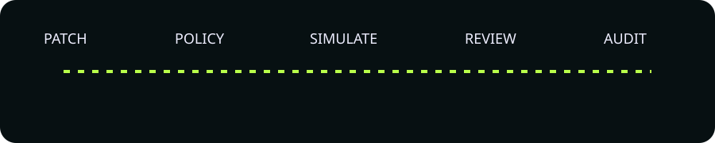
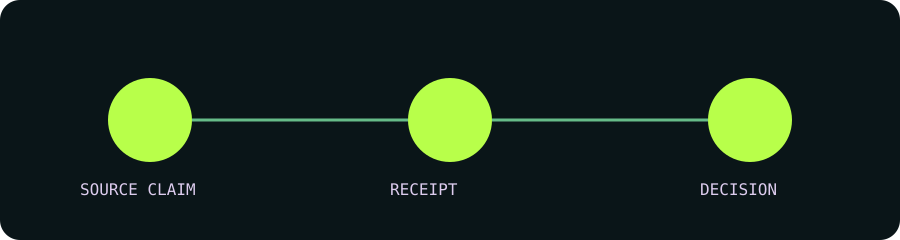

# Patch Cage

> A change-safety operations product that proves a patch is reviewable before it can create a release effect.

Patch Cage connects a polished React workbench to a versioned Rust API, explicit middleware, 23 meaningful Rust crates, five Ruvnet upstream projects, two enterprise OSS projects, and append-only RuVector/RVF evidence.

## Launch

`./scripts/bootstrap.sh && ./scripts/start.sh` then open http://127.0.0.1:4173. Backend readiness: http://127.0.0.1:8080/v1/readiness.

## Product workflows

- Intake a real unified diff and inspect repository-aware risk, evidence and precedent.
- Exercise policy denial with proof that no release effect occurred, then recover.
- Approve and retrieve the same append-only assessment after backend restart.
- Inspect every upstream boundary, ablation and correlation ID.

## Composition

See [integration matrix](docs/integration-matrix.md), [crate map](docs/crate-map.md), [architecture](docs/architecture.md), [ADRs](docs/adr/README.md), [DDDs](docs/ddd/README.md), [research](docs/research.md), and [prototype acceptance](docs/prototype-acceptance.md).

## Verification

`DREAM_MACHINE_EVIDENCE_DIR=/tmp/patch-cage-evidence ./scripts/verify-prototype.sh` runs Rust format/clippy/tests, frontend typecheck/lint/unit/build, API drift, middleware denial, integrations, benchmark, ablations, container build and all three Playwright journeys. The corrected October 29 product checker is copied verbatim in `scripts/dream-machine-product-gate.mjs`.

## Maturity and limitations

Synthetic seed data is clearly labeled. Production deployment, spend and promotion are not performed. External tools are pinned and fail closed; unavailable upstreams yield an integration-blocked verdict. RuVector/RVF is the authoritative store; no service-owned relational database exists.
